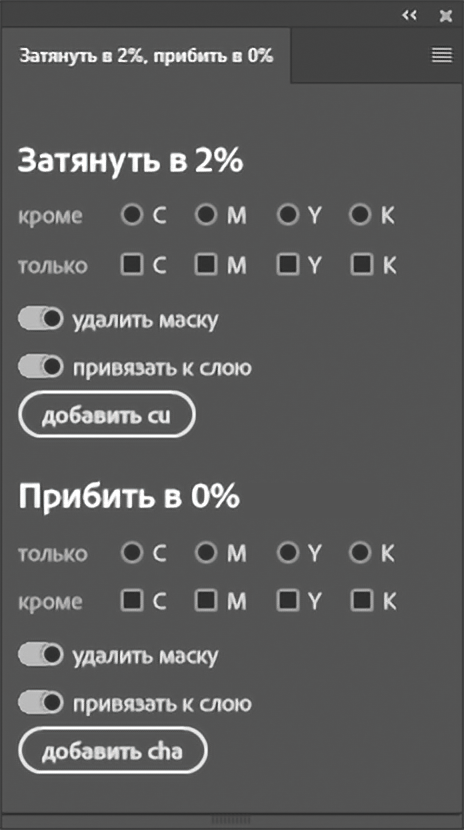

# [uxp] [photoshop] [html/css/js] cha0-cu2-helper

## Любые каналы CMYK на слое/документе   затягивает в 2% или прибивает в 0%

#### Постоянно использую эти функции в допечатной подготовке/цветокоррекции

## Совместимость

#### uxp-плагины работают, начиная с версии Шопа 22.0.0 (2020 год)
  
## Что делает

*  **Корректировочный слой добавляется к самому верхнему из выбранных активных слоев.**
* По нажатию кнопки `добавить cu` добавляет корректировочный слой `Curves`, который затягивает в `2%` один или несколько
  каналов `CMYK`.
* По нажатию кнопки `добавить cha` добавляет корриктеровочный слой `Channel mixer`, который **прибивает** один или несколько
  `CMYK` каналов.
* По умолчанию активна привязка `Curves` и `Channel mixer` к слою.
* По умолчанию маска корректировочного слоя удаляется.
* Привязка и удаление маски управляется соответствующими переключателями интерфейса.
* В названии корректировочного слоя указаны имена каналов, к которым применено действие.

<video width="640" height="360" controls>
  <source src="assets/video/uxp_psd_cha0-cu2-helper_1.mp4" type="video/mp4">
  Ваш браузер не поддерживает тег video.
</video>

## Под капотом

* Функции `cha0` и `cu2` - это экшны фотошопа, скопированный в `js` как основа (шаблон).
* Те или иные параметры меняются в шаблоне в согласии с изменениями элеменов интерфейса.
* Верстка интерфейса сделана на элементах `Adobe Spectrum` из-коробки, без загрузки дополнительных веб-компонентов
  библиотеки `Adobe Spectrum`.

## История версий

0.0.8
---

* Марафет

0.0.7
---

* bugfix - устранена ошибка, когда маска слоя не удалялась, если сверху был привязан еще слой

0.0.6
---

* В `cha0` функцию `только` поставил на радиокнопки, а функцию `кроме` поставил на флаги, потому что убрать в 0% ТОЛЬКО
  один канал более частая задача;
* например, в зелени мы обычно прибиваем `только` канал Magenta и тп).
 * todo:
   * добавить сохранение состояния интерфейса на диск (а нужно ли??);
   * нарисовать иконку нормальную;
   * переименовать в `uxp_psd_cha0-cu2-helper`;
   * потестировать плагин в работе пару недель.

0.0.5
---

* Написал `cha0.js`, для добавления Channel Mixer
* Добавил .gitignore
* Поправил ошибки
* Внес ошибки, поправлю в следующей итерации

0.0.2 - 0.0.4
---

* Написал функцию `cu2.js`, для добавления кривой.
* Добавил иконку плагина.

0.0.1
---

* Сверстал интерфейс.
